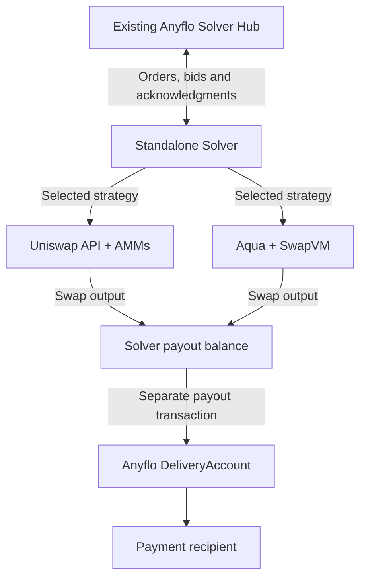

# Anyflo DeFi Provider

**Connecting business stablecoin payments with Uniswap AMMs and 1inch Aqua.**

An [ETHGlobal Mumbai](https://ethglobal.com/events/mumbai) project exploring how
DeFi liquidity can execute payment orders from Anyflo's existing system.

> **Status:** The standalone Solver and reproducible local demo are implemented.
> Both strategies execute real local swaps and Anyflo-style payouts; Aqua also
> demonstrates ship, fill and dock. The backend, provider HTTP responses and
> settlement contracts are explicitly labeled test doubles. No mainnet settlement
> or route-compliance implementation is claimed.

## Anyflo and the Solver

Anyflo orchestrates non-custodial stablecoin payments. Customers submit transfer
orders, Solvers bid to execute them, and the system coordinates order acceptance,
compliance and on-chain settlement.

A Solver is the liquidity and execution agent. It quotes a payment, accepts an
assignment, verifies customer funding and delivers the agreed asset to the
recipient. The existing Anyflo Solver uses its own payout inventory.

This project targets a small, standalone Solver that obtains payout liquidity
through Uniswap or Aqua instead of requiring inventory of every payout token.
It reuses Anyflo's existing API and order lifecycle rather than introducing a
new payment protocol.

## Presentation

- [Presentation PDF](presentation/anyflo-solver.pdf)
- [Presentation (typst deck)](presentation/deck.typ)
- [Demo evidence](presentation/evidence.json) - observed local demo artifacts.

## Goals

See the presentation (above) for busienss overview and user story and why we build Anyflo.
The hackathon project goals:

- Give Anyflo and its customers more liquidity options behind the same order API.
- Demonstrate business payment orders as a use case for Uniswap and Aqua.
- Use verified customer funding to swap into the required payout asset.
- Keep the implementation small and the demonstration reproducible.
- Clearly distinguish real protocol execution from mocked backend components.

Liquidity still requires funded pools or makers. This project does not create
credit, guarantee prices or remove the need for liquidity providers.

## Two execution strategies

### Uniswap AMMs

Use the Uniswap Trading API for quotes and transaction construction, then execute
an AMM swap within the accepted order's amount and slippage limits. The target is
same-chain Uniswap v2/v3/v4 liquidity, not UniswapX orders or a filler service.

Code: [API and router validation](src/uniswap.ts) ·
[developer feedback](FEEDBACK.md).

### 1inch Aqua and SwapVM

Build a custom, permissionless Aqua position app using the official SwapVM engine:
a concentrated stablecoin price band with an LP fee and time-based decay.
The Solver trades against a configured, wallet-backed maker position.

The on-chain SwapVM quote determines executable terms. A separate 1inch API quote
provides a market reference; a generic aggregator quote is not evidence of Aqua
liquidity or execution. This design does not require becoming a 1inch resolver
or discovering arbitrary positions through a global feed.

Code: [Aqua execution](src/aqua.ts) ·
[custom position builder and lifecycle](src/aqua-position.ts) ·
[maker CLI](scripts/aqua-position.ts).

## Integration



Quotes and bids precede customer funding. Swaps execute only after independent
deposit verification. The simplified Solver will use Anyflo's existing direct
deposit mode; protocol fees remain separate from the Solver's spendable input.
A swap receipt alone is not payment delivery: the final transaction uses
Anyflo's DeliveryAccount and the existing delivery acknowledgment.

## Hackathon scope

- Uniswap and Aqua only; one selected strategy per process.
- Fixed-input orders, one configured EVM chain/token pair and one active order.
- A small persistent checkpoint that prevents blind retries after ambiguous
  spending outcomes; manual reconciliation rather than production recovery.
- API credentials in private Solver configuration, never in source or demo logs.
- No Inventory fallback, Sui execution, cross-chain bridge, UniswapX, database
  migration system or general-purpose strategy framework.

The intended live pair is **bridged USDT to native USDC on Base**, not an
Arbitrum-to-Base bridge. Mainnet execution requires verified deployments,
appropriate funding and separate operator authorization; it is not claimed here.

## Run the local demo

Prerequisites: Bun 1.4.4+, Git, `tar`, and network access for the first public
dependency/compiler download. Foundry and Anvil are pinned npm dev dependencies;
there is no Docker stack or private backend checkout to start.

```sh
bun install --frozen-lockfile
bun run demo:setup
bun run demo --strategy both
```

Run either strategy independently, or exercise the safety scenarios:

```sh
bun run demo --strategy Uniswap
bun run demo --strategy Aqua
bun run demo --strategy Uniswap --scenario unfundedDeposit
bun run demo --strategy Uniswap --scenario completedRestart
```

The script owns and stops its local Anvil, mock Hub, provider mock and real Solver
child process. It generates test-only keys and private configuration; **no user
API key, registered live Solver or real funds are needed**. Never reuse the
deterministic Anvil wallets on a live chain.

### What is real, and what is mocked?

- **Real:** minted six-decimal test tokens, official Uniswap V3 pool/QuoterV2,
  Permit2 and Universal Router, official Aqua/SwapVM, maker wallet backing,
  ERC20 transfers, swap/payout receipts and final position balances.
- **Mocked:** the existing Anyflo Hub API, customer/coordinator role, provider
  HTTP responses for Anvil-only tokens, and small Anyflo settlement contracts.
  The Hub still verifies JWTs and canonical signatures; the Solver still verifies
  actual on-chain deposits and deliveries. No safety checks are bypassed.
- A 1inch HTTP reference is not an Aqua execution quote. The Aqua position is
  quoted and filled on-chain. Local provider HTTP data is not called a live API
  quote.

The Solver starts with zero input and output tokens. Each order credits 10 test
USDT to the Solver, separately pays a 0.1 test-USDT protocol fee, swaps 9.99 test
USDT and retains the configured 0.01 test-USDT input premium. The recipient gets
the accepted USDC payout through a **separate** DeliveryAccount transaction.
The JSON report checks those amounts and receipt identities.

Verification on this build: **43 Bun tests** and **5 native Forge settlement
tests** passed; the interactive Uniswap/Aqua runs passed **11/14 checks**. The
suite also proves that short funding produces no swap/payout and that completed
restart plus duplicate delivery does not spend twice. Funded restarts remain
manual, not an automatic-recovery claim.

```sh
bun run test:contracts
bun run test
```

The setup invokes platform-native Foundry executables and checks their exit
status: the npm launcher alone can hide a failing compiler/test exit. Downloaded
upstream source integrity can be checked with:

```sh
bun run scripts/setup-foundry.ts verify
```

Code: [shared demo harness](demo/run.ts) · [mock Hub](demo/hub.ts) ·
[local provider transport](demo/provider.ts) · [pinned setup](scripts/setup-foundry.ts).

Read-only live provider probes also returned HTTP 200, including a real Uniswap
quote through this runtime and unsigned transaction builds. Those probes did not
sign or broadcast a Base transaction. The local demo does **not** prove that the
private production backend, its compliance gates or mainnet settlement ran.

## Compliance: existing context and future work

Anyflo's existing backend provides customer access controls and counterparty
screening. The standalone mock-Hub demo does not execute those backend checks.

The longer-term goal is for the Solver to inspect the complete execution plan
and routes before bidding, then again before execution or a requote, checking
assets, venues and counterparties against policy.
**These route-compliance checks are outside the hackathon implementation.**
Ordinary transaction-safety validation is not a compliance engine or a claim of
regulatory certification.

## Development

This is an independent Bun repository, not a package in the Anyflo backend
workspace. It uses the public
[`@anyflo/lib`](https://gitlab.com/api/v4/projects/85458236/packages/npm/@anyflo/lib)
package for wire contracts, authentication and shared helpers. The package is
anonymously downloadable; access to the private backend source is not required.
There are no imports, symlinks or workspace dependencies into that source.

Use Bun 1.4.4 or newer:

```sh
bun install --frozen-lockfile
bun run demo:setup
bun run typecheck
bun run test:contracts
bun run test
bun run build
bun run start --help
```

### Private Solver configuration

```sh
mkdir -p private
chmod 700 private
cp solver.config.example.json private/solver.config.json
chmod 600 private/solver.config.json
```

Replace the example Hub identity and zero contract addresses with values
provisioned by your Anyflo operator. Configure the admitted token pair and chosen
strategy. Both `uniswapApiKey` and `oneInchApiKey` belong in this private JSON file;
examples and the local demo use placeholders or synthetic credentials.

Provide these private environment inputs without committing them:

- `EVM_PRIVATE_KEY`: the EVM signer whose address receives the direct deposit.
- `SOLVER_AUTH_JWK`: a private Ed25519 JWK for the registered Solver ID and key ID.
- `AQUA_MAKER_PRIVATE_KEY`: the separate LP maker key, only for explicitly
  authorized position-management transactions.

The configuration example is not a working mainnet deployment. `--check` performs
read-only RPC, contract/decimal and quote checks and never approves or transfers
tokens. `--execute` explicitly enables automatic transactions for funded orders:

```sh
bun run start --config private/solver.config.json --check --amount 10000000
bun run start --config private/solver.config.json --execute
```

API quotes can exceed Anyflo's normal 1.5-second auction. Use a 10-second auction
for this integration where your backend operator supports it; the Solver still
declines quotes that miss the actual broadcast deadline.

Keep configuration, signing keys, registry credentials and checkpoint state out
of commits. Funded or executing orders do not resume automatically after a
process restart. Reconcile transactions and order state with the operator;
never delete checkpoints to force another spend. Cleanly completed orders can
be restarted and acknowledge a verified duplicate delivery without paying twice.

The state directory's `.solver.lock` is not automatically stolen after a crash.
Before manually removing a stale process lock, confirm the recorded process is
gone and reconcile pending receipts. Removing that lock does **not** reconcile or
authorize an unresolved order. This is not a production recovery or automatic
refund system.

## Protocol and challenge references

- [Uniswap Trading API](https://developers.uniswap.org/docs/api-reference/aggregator_quote)
- [How Aqua works](https://1inch.com/aqua/learn/how-aqua-works)
- [Aqua position template](https://business.1inch.com/portal/documentation/aqua/getting-started/strategy-template)
- [Uniswap Mumbai challenge](https://ethglobal.com/events/mumbai/prizes/uniswap-foundation)
- [1inch Mumbai challenge](https://ethglobal.com/events/mumbai/prizes/1inch)

## License

[Mozilla Public License 2.0](LICENSE) for project-owned code. See
[third-party notices](THIRD_PARTY_NOTICES.md) for the separate SDK and contract
terms, including the source-available Aqua/SwapVM licenses. Public source and a
local demo do not grant unrestricted commercial or production rights.
