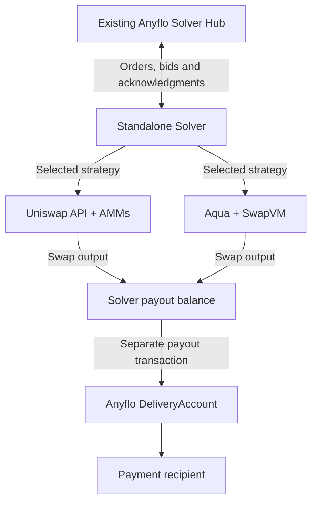

# Anyflo DeFi Provider

**Connecting business stablecoin payments with Uniswap AMMs and 1inch Aqua.**

An [ETHGlobal Mumbai](https://ethglobal.com/events/mumbai) project exploring how
DeFi liquidity can execute payment orders from Anyflo's existing system.

> **Status:** The repository currently contains the project setup and published
> library dependency. The Solver adapters, runnable demo and presentation described
> below are planned work, not completed or verified capabilities.

## Anyflo and the Solver

Anyflo orchestrates non-custodial stablecoin payments. Customers submit transfer
orders, Solvers bid to execute them, and the system coordinates order acceptance,
compliance and on-chain settlement.

A Solver is the liquidity and execution agent. It quotes a payment, accepts an
assignment, verifies customer funding and delivers the agreed asset to the
recipient. The existing Anyflo Solver uses its own payout inventory.

This project targets a small, standalone Solver that obtains payout liquidity
through Uniswap or Aqua instead of requiring inventory of every payout token.
It reuses Anyflo's existing API and order lifecycle rather than introducing a
new payment protocol.

## Goals

- Give Anyflo and its customers more liquidity options behind the same order API.
- Demonstrate business payment orders as a use case for Uniswap and Aqua.
- Use verified customer funding to swap into the required payout asset.
- Keep the implementation small and the demonstration reproducible.
- Clearly distinguish real protocol execution from mocked backend components.

Liquidity still requires funded pools or makers. This project does not create
credit, guarantee prices or remove the need for liquidity providers.

## Two execution strategies

### Uniswap AMMs

Use the Uniswap Trading API for quotes and transaction construction, then execute
an AMM swap within the accepted order's amount and slippage limits. The target is
same-chain Uniswap v2/v3/v4 liquidity, not UniswapX orders or a filler service.

### 1inch Aqua and SwapVM

Build a custom, permissionless Aqua position app using the official SwapVM engine:
a concentrated stablecoin price band with an LP fee and time-based decay.
The Solver trades against a configured, wallet-backed maker position.

The on-chain SwapVM quote determines executable terms. A separate 1inch API quote
provides a market reference; a generic aggregator quote is not evidence of Aqua
liquidity or execution. This design does not require becoming a 1inch resolver
or discovering arbitrary positions through a global feed.

## Planned integration



Quotes and bids precede customer funding. Swaps execute only after independent
deposit verification. The simplified Solver will use Anyflo's existing direct
deposit mode; protocol fees remain separate from the Solver's spendable input.
A swap receipt alone is not payment delivery: the final transaction uses
Anyflo's DeliveryAccount and the existing delivery acknowledgment.

## Hackathon scope

- Uniswap and Aqua only; one selected strategy per process.
- Fixed-input orders, one configured EVM chain/token pair and one active order.
- A small persistent checkpoint that prevents blind retries after ambiguous
  spending outcomes; manual reconciliation rather than production recovery.
- API credentials in private Solver configuration, never in source or demo logs.
- No Inventory fallback, Sui execution, cross-chain bridge, UniswapX, database
  migration system or general-purpose strategy framework.

The intended live pair is **bridged USDT to native USDC on Base**, not an
Arbitrum-to-Base bridge. Mainnet execution requires verified deployments,
appropriate funding and separate operator authorization; it is not claimed here.

## Planned demo and verification

The local demo will use Foundry/Anvil, freshly deployed six-decimal test tokens
and a mock Solver Hub that speaks the existing authentication and CBOR protocol.
The real Solver process will receive an order, bid, accept, verify funding, swap,
deliver and acknowledge.

Uniswap AMM and Aqua/SwapVM execution will use real local protocol contracts.
The Hub, provider HTTP responses for Anvil-only tokens, and minimal Anyflo
settlement fixtures will be explicitly labeled test doubles. Test fixtures must
move actual test tokens; prefunding the Solver's payout balance is not a
substitute for a swap.

The demo will show transaction receipts, recipient balance changes and final
Aqua position balances. It will not prove that the complete Anyflo production
backend, production compliance checks or mainnet settlement have run.

## Compliance: existing context and future work

Anyflo's existing backend provides customer access controls and counterparty
screening. The standalone mock-Hub demo does not execute those backend checks.

The longer-term goal is for the Solver to inspect the complete execution plan
and routes before bidding, then again before execution or a requote, checking
assets, venues and counterparties against policy.
**These route-compliance checks are outside the hackathon implementation.**
Ordinary transaction-safety validation is not a compliance engine or a claim of
regulatory certification.

## Development

This is an independent Bun repository, not a package in the Anyflo backend
workspace. It depends on the published
[`@anyflo/lib`](https://gitlab.com/api/v4/projects/85458236/packages/npm/@anyflo/lib)
and must not import or link source files from the backend's `packages/` tree.
Only essential code unavailable in the public library will be copied.

With Bun installed and access to the configured package registry:

```sh
bun install --frozen-lockfile
bun run typecheck
```

These are the current setup commands, not a Solver or demo launcher. Runtime,
demo and presentation commands will be documented alongside their implementation.
Keep registry tokens, provider API keys, private signing keys and runtime state
out of commits.

## Delivery roadmap

1. Implement the minimal two-strategy Solver, essential tests and usage docs;
   create a signed, signed-off implementation commit.
2. Add the mock Solver Hub, runnable Foundry demo and focused end-to-end tests;
   create a separate signed, signed-off commit.
3. Write presentation Markdown with integration-flow and swimlane Mermaid
   diagrams, actual demo evidence and the project's added value.
4. Convert the presentation to editable Typst slides and a rendered PDF.
5. Later, apply the researched modular-strategy design to the production
   Anyflo Solver. That monorepo work is not part of this implementation.

## Protocol and challenge references

- [Uniswap Trading API](https://developers.uniswap.org/docs/api-reference/aggregator_quote)
- [How Aqua works](https://1inch.com/aqua/learn/how-aqua-works)
- [Aqua position template](https://business.1inch.com/portal/documentation/aqua/getting-started/strategy-template)
- [Uniswap Mumbai challenge](https://ethglobal.com/events/mumbai/prizes/uniswap-foundation)
- [1inch Mumbai challenge](https://ethglobal.com/events/mumbai/prizes/1inch)

## License

[Mozilla Public License 2.0](LICENSE). Third-party protocol code retains its
own license and attribution requirements.
